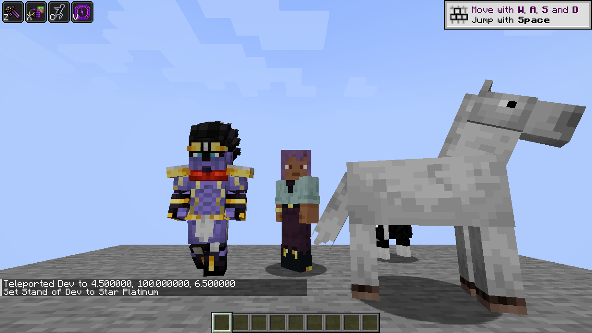
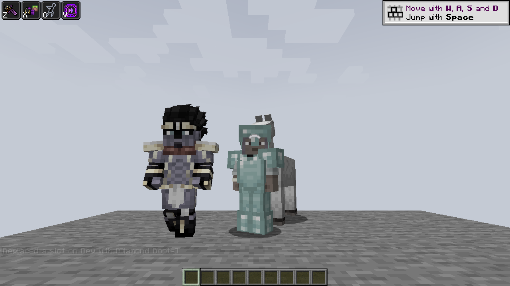
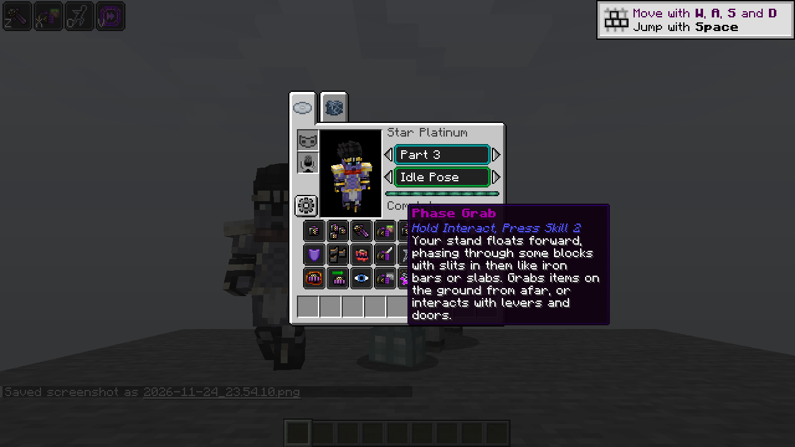
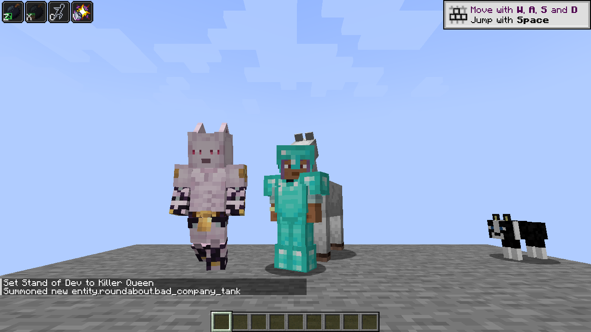
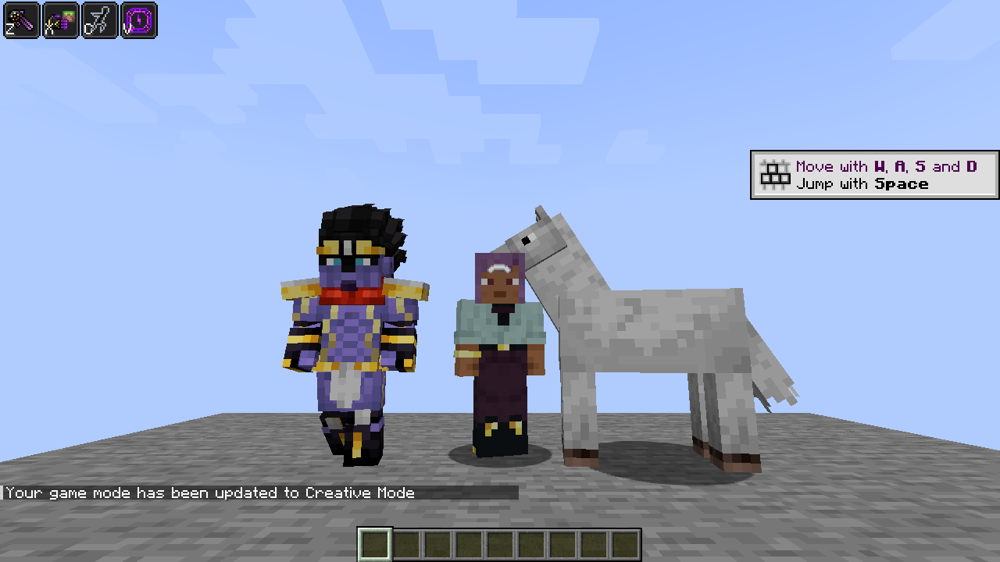

# Проверка игрового запуска

Среда: Minecraft 1.21.1, NeoForge 21.1.265, Java 21.0.6, Linux, программный OpenGL llvmpipe. Использованы настоящие клиент и сервер, скомпилированные из исходников порта. Снимки сделаны штатной клавишей F2. Это короткая проверка основных сценариев, не полная проверка мода.

## Проверенные сценарии

| Сценарий | Наблюдаемый результат |
| --- | --- |
| Загрузка клиента и вход в мир | Мир, игрок, мобы, HUD и чанки отрисовываются; обязательные mixin проходят загруженные пути |
| Движение и прыжок | Ввод обрабатывается, позиция игрока изменяется; падения из-за SmoothDouble нет |
| Star Platinum | Команда выдаёт стенд; R вызывает модель и показывает панель способностей |
| Броня | Все четыре алмазные части отображаются в третьем лице, в том числе при остановке времени |
| Остановка времени | V активирует эффект; повторное V возвращает обычный цвет и состояние интерфейса |
| Меню стенда | Y открывает модель, настройки и описания способностей |
| Killer Queen | Смена стенда, модель, HUD, скрытие и повторный вызов проходят без падения |
| Bad Company Tank | Серверная команда создания сущности успешно выполнена; бой/управление танком не проверялись |
| Сохранение и новый запуск клиента | Мир сохранён, клиент завершился с кодом 0; после нового запуска сохранены позиция, броня и диск Killer Queen |
| Отдельный сервер и TCP | Клиент подключился к 127.0.0.1; после R сервер подтвердил наличие Star Platinum, клиент отрисовал его |
| Остановка времени через сеть | Клиент показывает эффект остановки времени и возвращается к обычному изображению после повторного V |

Клавиши Z/X также нажимались без падения; правильность урона, дальности и баланса по этому тесту не оценивалась. Снимок брони при смене экипировки **другого замороженного игрока** ещё не проверен. Сетевой сценарий заканчивается штатным отключением клиента от сервера; штатное завершение обоих процессов в этих двух журналах не зафиксировано. Сетевой сценарий использовал одного клиента и локальный dev-сервер в offline mode; онлайн-аутентификация и взаимодействие нескольких игроков требуют отдельного теста.

## Повторение проверки

В новом тестовом мире с разрешёнными командами:

```text
/gamemode creative
/roundaboutSetStand @s star_platinum 10 0 0 false
```

Нажать R, переключиться F5 в третье лицо, проверить модель. Открыть Y и закрыть Escape. Нажать/удержать V для остановки времени, затем V для возобновления. В Creative остановка может оставаться активной до ручного возобновления. Для проверки экипировки:

```text
/item replace entity @s armor.chest with minecraft:diamond_chestplate
/item replace entity @s armor.head with minecraft:diamond_helmet
/item replace entity @s armor.legs with minecraft:diamond_leggings
/item replace entity @s armor.feet with minecraft:diamond_boots
/roundaboutSetStand @s killer_queen 10 0 0 false
```

Сохранить мир через меню, завершить клиент и открыть его заново. Проверить выбранный стенд и экипировку. Для отдельного сервера используется тот же мод на обеих сторонах. После выдачи Star Platinum и нажатия R серверная команда ниже проверяет, что создание стенда действительно произошло на сервере:

```text
execute if entity @e[type=roundabout:star_platinum] run say PORT_STAND_NETWORK_OK
```

## Журналы и ограничения

- [client-smoke.log](client-smoke.log): первый полный игровой сценарий и штатное сохранение/завершение.
- [client-reload.log](client-reload.log): новый запуск того же сохранения и повторное завершение.
- [multiplayer-server.log](multiplayer-server.log), [multiplayer-client.log](multiplayer-client.log): отдельные процессы и обмен по TCP.
- [server-client-checkpoint.log](server-client-checkpoint.log): отдельная финальная проверка повторной загрузки, наличия сущности с тестовым тегом, save-all flush и штатного stop (код 0).
- [build-errors.txt](build-errors.txt): полная clean build, 0 ошибок и 18 предупреждений.

Остаются девять отсутствующих звуковых файлов, отсутствующие переводы некоторых субтитров и три старых post-эффекта: desaturate, deconverge, phosphor. Это реальные недостатки ресурсов, а не ошибки среды. Некоторые shader uniforms/samplers также дают предупреждения и требуют проверки соответствующих способностей. Сам timestop загружается и отображается.

Запросы ключей Mojang недоступны в среде проверки. В первом журнале есть ошибка тестовой настройки simulationDistance=4; в повторном запуске значение исправлено на допустимые 5. Звуковой вывод проверялся через OpenAL null backend, прослушивание звука не выполнялось.

Не проверены все стенды, длительная игра, установка JAR в обычный лаунчер, разные видеокарты, несколько клиентов, переходы между измерениями и совместимость с другими модами.

## Снимки игры










